# keep-me-secure-mcp

**Ask your coding agent "Is my stack secure?" and get a yes or no, with what to do next.**

<picture>
  <source media="(prefers-color-scheme: dark)" srcset="assets/hero-dark.svg">
  
</picture>

[Website](https://keepmesecure.dev) · [Contributing](CONTRIBUTING.md) · [Security](SECURITY.md) · MIT license

It's a free, open source MCP server. It checks every package in your lockfiles against public security advisories, including the ones you didn't install directly.

## Quick start

Add it to Claude Code. You need Node.js 22 or newer, and no account or Docker.

```bash
claude plugin install keep-me-secure --marketplace robertkeus/keep-me-secure-mcp
```

Now it checks by itself when you start coding, once a day per project. You can also ask your agent at any time:

```text
Is my stack secure?
```

It never changes anything without your OK.

## Ways to use it

| | Claude Code plugin | Docker | Hosted URL |
|---|---|---|---|
| **Best for** | Daily use in Claude Code | Other agents, isolation | Trying it, small projects |
| **You need** | Node.js 22 or newer | Docker | Nothing |
| **Daily check** | Yes | Yes | No, you ask |
| **Who reads your lockfiles** | The plugin, on your machine | The container, on your machine | Your agent, which sends the list to our server |
| **Coverage** | Every package | Every package | What your agent sends |

### Docker

Run this in your project:

```bash
docker run --rm --user "$(id -u):$(id -g)" -v "$PWD:/workspace" ghcr.io/robertkeus/keep-me-secure-mcp:latest init
```

This adds or updates three files:

| File | Purpose |
|---|---|
| `.mcp.json` | Registers the MCP server |
| `.claude/settings.json` | Claude Code hook that runs the check when a session starts |
| `AGENTS.md` | Tells other agents to run the check at the start of a session |

The config pins the image version, so a new release never reaches your project unannounced. Run the command again to upgrade.

For other agents, keep the `AGENTS.md` rule: in testing, Codex only called the tool when that rule was present.

<details>
<summary>Codex</summary>

In `~/.codex/config.toml`:

```toml
[mcp_servers.keep-me-secure]
command = "sh"
args = ["-c", "exec docker run -i --rm --read-only --cap-drop=ALL --security-opt=no-new-privileges -v \"$PWD:/workspace:ro\" -v kms-cache:/cache ghcr.io/robertkeus/keep-me-secure-mcp:latest"]
```

</details>

<details>
<summary>opencode</summary>

In `opencode.json`:

```json
{
  "mcp": {
    "keep-me-secure": {
      "type": "local",
      "command": ["sh", "-c", "exec docker run -i --rm --read-only --cap-drop=ALL --security-opt=no-new-privileges -v \"$PWD:/workspace:ro\" -v kms-cache:/cache ghcr.io/robertkeus/keep-me-secure-mcp:latest"],
      "enabled": true
    }
  }
}
```

</details>

Tested with Claude Code, Codex and opencode. Cursor and other MCP clients should work with the same command, but haven't been tested. The agent must start in your project folder, because `$PWD` is what gets scanned.

### Hosted URL

Add `https://mcp.keepmesecure.dev/mcp` as a remote MCP server in your agent. No account or token is needed, and each IP address gets 20 checks per minute.

- Your agent reads your lockfiles and sends package names and versions, so coverage depends on your agent. In one test it sent only 19 of 39 packages. Use the plugin or Docker when coverage matters.
- Your agent is told to leave out private packages, but that isn't enforced. If your package names are sensitive, run it locally.
- The server doesn't log or store package lists, and Worker logging is turned off. Package names and versions are passed to OSV, and Cloudflare may keep its own standard request data.
- Every package is treated as a direct dependency, so check the suggested command for transitive ones.

## What it checks

| Language | Reads |
|---|---|
| PHP | `composer.lock` |
| JavaScript | `package-lock.json`, `pnpm-lock.yaml`, `yarn.lock` |
| Python | `requirements*.txt`, `poetry.lock`, `uv.lock` |
| Go | `go.mod` |
| Rust | `Cargo.lock` |
| Ruby | `Gemfile.lock` |
| Java, Kotlin | `gradle.lockfile` |
| .NET | `packages.lock.json` |

Lockfiles in test and example folders (such as `test`, `spec`, `fixtures` and `examples`) are skipped, because they usually don't ship. They're listed in `coverage.ignored`, and `check_project` still checks one if you name it with `path`.

Maven has no lockfile, so `pom.xml` projects return `unknown`. So do Gradle and .NET projects with locking turned off.

## Platform breaches

Packages aren't the only risk. In October 2026 alone, several developer and AI platforms disclosed incidents where customer secrets may have been exposed. If your project uses one, Keep Me Secure tells you what happened and what to do, with a link to the source.

- **Detection:** it looks for files such as `railway.toml`, `vercel.json`, `zbpack.json` and `trigger.config.ts`, and for packages such as `@trigger.dev/sdk`. Platforms that leave no trace in a repo aren't detected, so ask your agent, for example "Was Northflank breached?".
- **The list:** no public database of platform incidents exists, so we keep [a curated list](https://keepmesecure.dev/incidents), taken from what each company has said. It isn't complete, so an empty result doesn't mean a platform is safe.
- **Updates:** the plugin and Docker versions fetch [the list](https://keepmesecure.dev/incidents.json) once a day, which sends nothing about your project. The feed can only add incidents: the ones shipped with each release always stay, and every entry is validated. It isn't signed yet.
- **Reporting:** the session-start message mentions incidents from the last 90 days. `check_platform` always shows all of them. Platform incidents are reported separately and don't change the package verdict.

To add an incident, open a pull request that edits `src/platforms.ts` and links the company's own statement.

## Tools

| Tool | Question it answers | Input |
|---|---|---|
| `check_project` (local) | Is my stack secure? Do I need to patch anything? | `ecosystem`, `path` and `refresh`, all optional |
| `check_packages` (hosted) | Is my stack secure? | `packages`, a list of up to 500 |
| `check_package` | Is this exact version safe? | `ecosystem`, `name`, `version` |
| `check_platform` | Was this platform breached? | `name`, optional. Omit it to list all |

Example result, shortened:

```json
{
  "verdict": "yes",
  "urgency": "today",
  "findings": [{
    "package": "guzzlehttp/guzzle",
    "installed": "7.4.0",
    "fixed_in": "7.15.2",
    "direct": true,
    "severity": "HIGH",
    "exploited": false,
    "advice": "Upgrade guzzlehttp/guzzle to 7.15.2 or later.",
    "command": "composer update guzzlehttp/guzzle --with-dependencies"
  }],
  "coverage": { "scanned": 2, "by_ecosystem": { "Packagist": 2 }, "private": ["acme/internal"], "unchecked": [] }
}
```

### Verdicts

- `yes`: at least one installed version has a known advisory.
- `no`: every package was checked and none has a known advisory.
- `unknown`: the check was incomplete, for example a missing lockfile, an unsupported ecosystem or a failed lookup. `coverage.unchecked` says why. Don't read this as safe.

### Urgency

- `now`: a malicious package, or a vulnerability in the [CISA KEV](https://www.cisa.gov/known-exploited-vulnerabilities-catalog) list of actively exploited issues.
- `today`: critical, high or unrated severity.
- `this_week`: everything else.

For malicious packages, upgrading isn't enough. The advice is to remove the package, rotate secrets and check for changes it may have made.

## Data and privacy

- Names and versions of public packages are sent to [OSV.dev](https://osv.dev). When something is affected, CVE ids go to [FIRST EPSS](https://www.first.org/epss/). The CISA KEV feed is downloaded.
- Packages from private registries, git or local paths are not sent anywhere. They're listed in `coverage.private` and aren't checked.
- Go, Java, .NET and most pnpm lockfiles don't show which registry a package came from, so private package names in those can be sent to OSV. Local `replace` paths in `go.mod` are the exception.
- Results are cached per day, in `~/.cache/keep-me-secure` for the plugin and the `kms-cache` volume for Docker. A lockfile change triggers a new check.

## Security

- The Docker container gets your project read-only, runs as a non-root user with a read-only filesystem and no capabilities.
- It never installs or upgrades anything. The agent proposes a command and you approve it.
- Images are published with provenance and an SBOM.
- Anything that reaches your agent is treated as untrusted. Package names, versions and advisory ids must match strict patterns, file paths and lockfile text are reduced to safe characters, and advisory text is shortened, flattened and labelled `summary_untrusted`. That last field is still third-party text, so agents are told to treat it as data.

To report a vulnerability, see [SECURITY.md](SECURITY.md).

## Limits

- It covers third-party packages and a curated list of platform incidents, not language runtimes, OS packages, Docker base images or your own code. A `no` doesn't mean your whole stack is secure.
- A `no` means no known issue at `checked_at`. OSV can lag behind an incident by a few hours.
- It doesn't check whether your code actually reaches the vulnerable function.
- For a transitive dependency, the fix may have to come from upgrading its parent package.

## Self-hosting

You can run the HTTP server yourself:

```bash
docker run --rm -p 8080:8080 --read-only --cap-drop=ALL -v kms-cache:/cache ghcr.io/robertkeus/keep-me-secure-mcp:latest serve
```

The endpoint is `/mcp`, and `/health` is for health checks. Rate limits are kept in memory, per instance. Set `PORT` to change the port. Set `KMS_TRUST_PROXY=1` only behind a proxy that adds `X-Forwarded-For`, so rate limits apply to the real client.

## Contributing

See [CONTRIBUTING.md](CONTRIBUTING.md). This project is MIT licensed.

## Development

```bash
docker compose build
```

```bash
docker compose run --rm test
```

```bash
docker compose run --rm -e LIVE=1 test
```

To try it on a vulnerable project:

```bash
PROJECT_DIR=./test/fixtures/php docker compose run --rm -T mcp check
```

To run the Cloudflare Worker locally:

```bash
npx wrangler dev
```

Pushing a `v*` tag publishes the image to GHCR.
